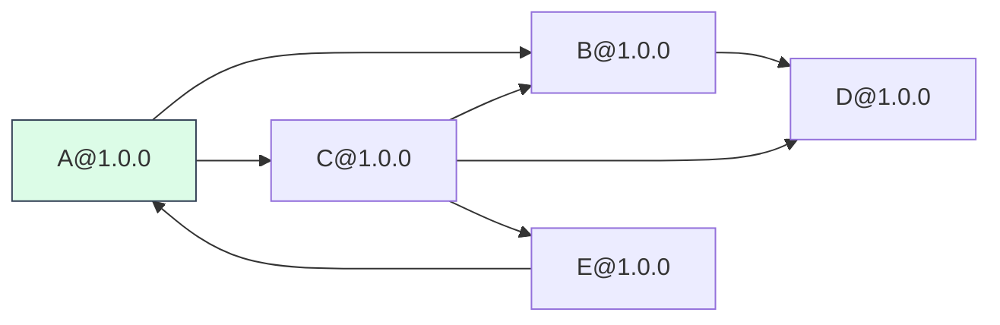
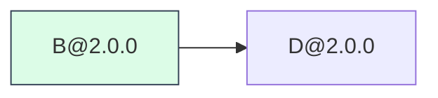
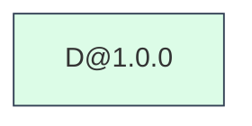

# Dependency Graph Visualizer

CLI-приложение для анализа зависимостей пакетов Rust (Cargo).

**Практическая работа № 2, вариант 19.**

Приложение получает зависимости пакетов из Cargo-совместимого реестра или локального тестового JSON, строит
граф зависимостей рекурсивным обходом в ширину (BFS) и определяет порядок обнаружения зависимостей.

## Выполненные этапы

1. **Настройка CLI.** Реализованы параметры командной строки, проверка входных данных и обработка ошибок.
2. **Получение прямых зависимостей.** Реализовано получение зависимостей указанной версии Cargo-пакета через
   HTTP API и чтение тестового JSON.
3. **Построение графа зависимостей.** Реализован рекурсивный BFS с ограничением глубины, обработкой циклов и
   поддержкой разных версий пакетов.
4. **Порядок загрузки зависимостей.** Реализован вывод порядка обнаружения зависимостей в BFS и выполнено
   сравнение с настоящим менеджером пакетов Cargo.
5. **Визуализация.** Создание Mermaid-описания и SVG из одного графа зависимостей.


## Параметры командной строки

| Параметр | Назначение |
| --- | --- |
| `--package` | Имя анализируемого пакета (обязательный параметр). |
| `--repository` | URL Cargo-реестра или путь к тестовому JSON (обязательный параметр). |
| `--test-mode` | Включение тестового режима с использованием локального JSON. |
| `--version` | Точная версия анализируемого пакета (обязательный параметр). |
| `--output` | Путь к SVG-файлу (по умолчанию `dependency_graph.svg`). |
| `--max-depth` | Максимальная глубина обхода (по умолчанию `5`). |
| `--show-load-order` | Вывод порядка обнаружения зависимостей вместо графа. |
| `--visualize` | Вывести Mermaid и сохранить файлы SVG и MMD. |

Параметр `--max-depth` ограничивает количество рёбер от корневого пакета до обнаруживаемых зависимостей.

- При глубине `0` граф содержит только корневой пакет.
- При глубине `1` обнаруживаются только непосредственные зависимости.
- При глубине `2` дополнительно обнаруживаются зависимости непосредственных зависимостей.

Даже при глубине `0` выполняется проверка существования корневого пакета и его версии.

Параметр `--output` задаёт путь сохранения SVG.
При использовании `--visualize` создаются два файла:
изображение SVG и описание графа Mermaid (`.mmd`).

## Структура программы и описание функций

### `src/config.py` — параметры командной строки

Модуль отвечает за создание CLI, чтение аргументов и проверку значений.

- `AppConfig` — неизменяемый класс конфигурации приложения.
- `AppConfig.as_dict` — преобразует конфигурацию в словарь.
- `validate_package` — проверяет правильность имени пакета.
- `validate_version` — проверяет формат версии пакета.
- `validate_output` — проверяет имя выходного SVG-файла.
- `validate_depth` — проверяет неотрицательную глубину обхода.
- `is_http_url` — проверяет, является ли значение HTTP(S)-адресом.
- `_add_graph_options` — добавляет параметры глубины и порядка загрузки.
- `build_parser` — создаёт парсер параметров командной строки.
- `parse_config` — разбирает аргументы и формирует объект `AppConfig`.

Для обработки параметров используется стандартная библиотека `argparse`.

### `src/cargo.py` — получение зависимостей Cargo

Модуль отвечает за взаимодействие с Cargo-совместимым HTTP API, разбор зависимостей и выбор версий.

- `Dependency` — хранит информацию о зависимости.
- `DependencyError` — представляет ошибки получения и обработки зависимостей.
- `_parse_dependency_record` — проверяет одну запись зависимости из ответа API.
- `_dependency_sort_key` — задаёт ключ сортировки зависимостей.
- `build_dependencies_url` — формирует адрес API для получения зависимостей конкретной версии.
- `parse_dependencies` — проверяет и преобразует список зависимостей из JSON.
- `fetch_json` — выполняет HTTP-запрос, декодирует JSON и обрабатывает ошибки.
- `fetch_dependencies` — получает непосредственные зависимости заданной версии пакета.
- `_read_test_graph` — читает тестовый JSON второго этапа.
- `_validate_test_graph_package_name` — проверяет имена пакетов в тестовом JSON второго этапа.
- `_validate_test_graph_dependencies` — проверяет списки зависимостей.
- `_raise_invalid_test_dependencies` — формирует исключение при неправильном списке зависимостей.
- `_validate_test_graph` — проверяет структуру тестового графа второго этапа.
- `load_test_dependencies` — возвращает непосредственные зависимости из тестового JSON второго этапа.
- `get_direct_dependencies` — выбирает источник прямых зависимостей в зависимости от режима приложения.
- `build_versions_url` — формирует URL для получения списка версий пакета.
- `_numeric_version` — преобразует стабильную версию в набор числовых компонентов.
- `_compare_explicit_operator` — сравнивает версии с использованием операторов `>=`, `<=`, `>`, `<` и `=`.
- `_tilde_upper_bound` — вычисляет верхнюю границу ограничения с оператором `~`.
- `_caret_upper_bound` — вычисляет верхнюю границу ограничения с оператором `^`.
- `_matches_version_range` — проверяет соответствие версии заданному диапазону.
- `_requirement_matches_token` — проверяет отдельную часть ограничения версии.
- `version_satisfies` — определяет совместимость версии с поддерживаемыми требованиями Cargo.
- `_matching_versions` — выбирает подходящие версии, исключая отозванные.
- `resolve_dependency_version` — выбирает наиболее новую подходящую стабильную версию зависимости.

HTTP-запросы выполняются средствами стандартной библиотеки Python.

Установка Cargo для работы самого приложения не требуется.

Алгоритм разрешения версий является упрощённым и не воспроизводит все правила настоящего Cargo.

### `src/versioned_repository.py` — тестовый репозиторий с версиями

Модуль реализует работу с локальным тестовым репозиторием третьего этапа.

- `VersionedRepository` — хранит данные тестового репозитория.
- `__init__` — загружает JSON и проверяет корректность зависимостей.
- `_check_package` — проверяет имя пакета.
- `_check_version` — проверяет формат версии.
- `_parse_dependency` — преобразует JSON-запись в объект `Dependency`.
- `_parse_graph` — проверяет структуру тестового графа.
- `_read_graph` — читает и разбирает JSON-файл.
- `_validate_references` — проверяет существование версий, на которые ссылаются зависимости.
- `dependencies` — возвращает непосредственные зависимости конкретной версии пакета.

В тестовом режиме имена пакетов должны состоять из заглавных латинских букв.

### `src/graph.py` — построение графа зависимостей

Модуль реализует рекурсивный обход в ширину (BFS).

- `node_id` — создаёт уникальный идентификатор узла в формате `имя@версия`.
- `GraphBuilder.__init__` — инициализирует состояние обхода и структуру графа.
- `GraphBuilder.build` — запускает построение графа и проверяет глубину.
- `GraphBuilder._expand_level` — рекурсивно обрабатывает очередной уровень BFS.
- `GraphBuilder._add_edges` — добавляет рёбра и регистрирует обнаруженные узлы.
- `build_dependency_graph` — создаёт объект `GraphBuilder` и возвращает граф.

Граф представлен словарём, в котором ключами являются идентификаторы пакетов с версиями, а значениями — списки
зависимостей.

Для предотвращения бесконечного обхода циклических зависимостей используется множество уже обнаруженных узлов.

Разные версии одного пакета рассматриваются как разные узлы.

### `src/load_order.py` — порядок загрузки зависимостей

Модуль реализует четвёртый этап.

- `dependency_load_order` — вычисляет порядок обнаружения зависимостей на основе построенного графа.

Функция использует обход в ширину с очередью `deque`.

Особенности алгоритма:

1. Обход начинается с корневого пакета.
2. Непосредственные зависимости обрабатываются раньше транзитивных.
3. Соседние узлы сортируются по идентификатору пакета и версии.
4. Каждая конкретная версия пакета добавляется в результат только один раз.
5. Циклические зависимости не приводят к бесконечному обходу.
6. Корневой пакет не включается в собственный список загрузки.
7. Отсутствующие в графе зависимости вызывают ошибку.

Результат представляет собой детерминированный порядок обнаружения зависимостей.

### `src/main.py` — запуск приложения

Модуль объединяет конфигурацию, получение зависимостей, построение графа и вывод результатов.

- `print_graph` — выводит построенный граф.
- `print_load_order` — выводит пронумерованный порядок зависимостей.
- `test_version` — возвращает точную версию тестовой зависимости.
- `make_loaders` — выбирает функции получения зависимостей и разрешения версий.
- `registry_loader` — загружает зависимости из HTTP-реестра.
- `registry_version` — разрешает версию зависимости по требованиям Cargo.
- `main` — управляет запуском приложения и обработкой ошибок.

Функции `registry_loader` и `registry_version` определены внутри `make_loaders`.

### `src/visualization.py` — визуализация

- `_graph_depths` — вычисление уровней BFS и проверка целостности графа.
- `to_mermaid` — генерация текстового описания Mermaid.
- `_node_layout` — расположение узлов по уровням графа.
- `_edge_path` — построение направленных связей.
- `_svg_edges` — отрисовка рёбер.
- `_svg_nodes` — отрисовка узлов и подписей.
- `to_svg` — создание изображения SVG.
- `save_visualization` — сохранение файлов Mermaid и SVG.

## Тестовый JSON с версиями

Для тестирования используется файл:

`tests/data/versioned_graph.json`

Он содержит пакеты, их версии и непосредственные зависимости каждой версии.

Пример структуры:

```json
{
  "A": {
    "1.0.0": [
      {"name": "B", "version": "1.0.0"}
    ],
    "2.0.0": [
      {"name": "B", "version": "2.0.0"}
    ]
  },
  "B": {
    "1.0.0": [],
    "2.0.0": []
  }
}
```

Каждый пакет может иметь несколько версий с разными зависимостями.

Например:

- `A@1.0.0` зависит от `B@1.0.0`.
- `A@2.0.0` зависит от `B@2.0.0`.

Узлы `B@1.0.0` и `B@2.0.0` не объединяются.

Тестовый репозиторий проверяет корректность структуры JSON, имён, версий и ссылок на существующие пакеты.

В используемом тестовом графе предусмотрены:

- Разные версии одного пакета.
- Пакеты без зависимостей.
- Общие зависимости.
- Циклические зависимости.
- Несколько уровней транзитивных зависимостей.

Файл `tests/data/test_graph.json` содержит тестовые данные второго этапа в исходном формате без версий.

Он сохранён для проверки функциональности предыдущего этапа.

## Третий этап: рекурсивный BFS

Построение графа начинается с заданной версии корневого пакета.

На каждом уровне алгоритм получает непосредственные зависимости обнаруженных пакетов и добавляет соответствующие рёбра.

После обработки текущего уровня выполняется рекурсивный переход к следующему.

Такой подход обеспечивает обход в ширину при рекурсивной реализации.

### Обработка циклов

В тестовом графе присутствует цикл:

```text
A@1.0.0 -> C@1.0.0 -> E@1.0.0 -> A@1.0.0
```

Когда алгоритм повторно обнаруживает `A@1.0.0`, ребро сохраняется, но узел не раскрывается повторно.

Это предотвращает бесконечный обход.

### Ограничение глубины

При `--max-depth 0` граф содержит только корневой пакет.

При `--max-depth 1` отображаются непосредственные зависимости.

При увеличении глубины постепенно добавляются транзитивные зависимости.

### Пример запуска

```bash
./run.sh --package A --version 1.0.0 \
  --repository tests/data/versioned_graph.json \
  --test-mode --max-depth 5
```

Результат:

```text
Dependency graph:
A@1.0.0 -> B@1.0.0, C@1.0.0
B@1.0.0 -> D@1.0.0
C@1.0.0 -> B@1.0.0, D@1.0.0, E@1.0.0
D@1.0.0 -> (none)
E@1.0.0 -> A@1.0.0
```

## Четвёртый этап: порядок загрузки зависимостей

На четвёртом этапе реализован вывод порядка обнаружения зависимостей.

Для этого используется дополнительный параметр:

```text
--show-load-order
```

Порядок определяется обходом построенного графа в ширину (BFS).

Сначала обрабатываются непосредственные зависимости корневого пакета, затем зависимости следующего уровня и так далее.

Узлы сортируются по идентификаторам, благодаря чему результат является детерминированным.

**Важно:** порядок обнаружения при BFS не гарантирует совпадения с фактическим порядком скачивания пакетов
менеджером Cargo.

### Демонстрация на тестовом репозитории

Для пакета `A@1.0.0`:

```bash
./run.sh --package A --version 1.0.0 \
  --repository tests/data/versioned_graph.json \
  --test-mode --max-depth 5 --show-load-order
```

Результат:

```text
Dependency load order (BFS discovery, root excluded):
1. B@1.0.0
2. C@1.0.0
3. D@1.0.0
4. E@1.0.0
```

Пакеты обнаружены в порядке уровней BFS.

Циклическая зависимость `E@1.0.0 -> A@1.0.0` не вызывает повторного добавления корневого пакета.

### Демонстрация для другой версии

Для `A@2.0.0`:

```bash
./run.sh --package A --version 2.0.0 \
  --repository tests/data/versioned_graph.json \
  --test-mode --max-depth 5 --show-load-order
```

Результат:

```text
Dependency load order (BFS discovery, root excluded):
1. B@2.0.0
2. C@1.0.0
3. D@2.0.0
4. B@1.0.0
5. D@1.0.0
6. E@1.0.0
7. A@1.0.0
```

Здесь `A@1.0.0` появляется в результате, потому что это другая версия корневого пакета `A@2.0.0`, достижимая
через зависимости.

Для алгоритма эти версии представляют собой разные узлы.

При глубине `1` обнаруживаются только непосредственные зависимости.

При глубине `0` список загрузки пуст.

## Сравнение с настоящим менеджером пакетов Cargo

Для проверки четвёртого этапа проведён эксперимент с реальным менеджером пакетов Cargo.

Цель эксперимента — сравнить состав и версии обнаруженных зависимостей, а также объяснить различия между
порядком BFS и поведением Cargo.

### Условия эксперимента

| Параметр | Значение |
| --- | --- |
| Анализируемый пакет | `serde_json` |
| Версия корневого пакета | `1.0.100` |
| Реестр | `https://crates.io` |
| Максимальная глубина | `2` |
| Алгоритм программы | BFS |
| Версия Cargo | Установленная через пакетный менеджер Ubuntu |
| Режим сравнения | Реальный HTTP API и `cargo tree` |

Эксперимент выполнялся с использованием установленного Cargo и подключения к crates.io.

### Результат собственной программы

Запуск:

```bash
./run.sh \
  --package serde_json \
  --version 1.0.100 \
  --repository https://crates.io \
  --max-depth 2 \
  --show-load-order
```

Результат:

```text
Dependency load order (BFS discovery, root excluded):
1. automod@1.0.17
2. indexmap@2.14.2
3. indoc@2.0.8
4. itoa@1.0.19
5. ref-cast@1.0.27
6. rustversion@1.0.23
7. ryu@1.0.23
8. serde@1.0.229
9. serde_bytes@0.11.19
10. serde_derive@1.0.229
11. serde_stacker@0.1.14
12. trybuild@1.0.122
13. proc-macro2@1.0.107
14. quote@1.0.47
15. syn@2.0.119
16. arbitrary@1.5.0
17. borsh@1.8.1
18. equivalent@1.0.3
19. fastrand@2.5.0
20. fnv@1.0.7
21. hashbrown@0.17.1
22. itertools@0.14.0
23. quickcheck@1.1.0
24. rayon@1.12.0
25. serde_core@1.0.229
26. sval@2.22.0
27. unindent@0.2.4
28. criterion@0.8.2
29. no-panic@0.1.37
30. ref-cast-impl@1.0.27
31. ref-cast-test-suite@0.0.0
32. num_cpus@1.17.0
33. rand@0.10.3
34. rand_core@0.10.1
35. rand_xorshift@0.5.0
36. bincode@2.0.1
37. serde_test@1.0.177
38. syn@3.0.10
39. serde_json@1.0.154
40. stacker@0.1.25
41. dissimilar@1.0.11
42. glob@0.3.4
43. target-tuple@1.0.2
44. termcolor@1.4.1
45. toml@1.2.1+spec-1.1.0
```

**Собственная программа обнаружила 45 узлов зависимостей.**

При этом версия исходного пакета осталась `serde_json@1.0.100`.

Появление `serde_json@1.0.154` среди зависимостей связано с тем, что расширенный граф включает другую версию
того же пакета, достижимую через зависимости.

Программа различает версии и рассматривает их как отдельные узлы.

### Результат настоящего Cargo

Для сравнения был создан отдельный проект:

```bash
cd /tmp
cargo new cargo-comparison
cd cargo-comparison
```

В файл `Cargo.toml` добавлена зависимость:

```toml
[dependencies]
serde_json = "=1.0.100"
```

После этого выполнены команды:

```bash
cargo fetch -v
cargo tree -p serde_json --depth 2
```

Команда `cargo fetch -v` вывела:

```text
Updating crates.io index
Locking 10 packages to latest Rust 1.93.1 compatible versions
Adding serde_json v1.0.100 (available: v1.0.154)
Downloaded itoa v1.0.19
Downloaded quote v1.0.47
Downloaded serde_core v1.0.229
Downloaded unicode-ident v1.0.27
Downloaded serde_derive v1.0.229
Downloaded ryu v1.0.23
Downloaded proc-macro2 v1.0.107
Downloaded serde v1.0.229
Downloaded serde_json v1.0.100
Downloaded syn v3.0.10
Downloaded 10 crates (854.4KiB) in 1.66s
```

Cargo сообщил о скачивании 10 пакетов, включая сам `serde_json`.

Команда просмотра дерева:

```bash
cargo tree -p serde_json --depth 2
```

Вывела:

```text
serde_json v1.0.100
├── itoa v1.0.19
├── ryu v1.0.23
└── serde v1.0.229
    └── serde_core v1.0.229
```

Таким образом, на глубине 2 Cargo показывает четыре зависимых пакета, не считая корневого `serde_json`.

Количество загруженных пакетов больше количества показанных в дереве из-за ограничения глубины вывода `cargo tree`.

### Сравнение результатов

| Пакет | Собственная программа | Cargo | Совпадение |
| --- | --- | --- | --- |
| `itoa` | `1.0.19` | `1.0.19` | Да |
| `ryu` | `1.0.23` | `1.0.23` | Да |
| `serde` | `1.0.229` | `1.0.229` | Да |
| `serde_core` | `1.0.229` | `1.0.229` | Да |

**Все четыре зависимости, показанные Cargo на глубине 2, обнаружены собственной программой с совпадающими версиями.**

Однако количество обнаруженных узлов отличается:

| Показатель | Собственная программа | Cargo |
| --- | ---: | ---: |
| Глубина анализа | 2 | 2 |
| Количество зависимых узлов | 45 | 4 |
| Учитываемые категории зависимостей | Все записи API | Разрешённые активные зависимости |
| Алгоритм вывода | BFS | Дерево Cargo |
| Учитываются разные версии одного пакета | Да | Да |

Собственная программа обнаружила на 41 узел больше, чем показано в дереве Cargo на выбранной глубине.

### Причины расхождений

**1. Различия в типах зависимостей**

Собственная программа анализирует все зависимости, возвращаемые API crates.io, включая обычные, сборочные,
тестовые и необязательные.

При подключении библиотеки к проекту Cargo учитывает типы зависимостей и их применимость к конкретной сборке.

Например, зависимости для разработки самой библиотеки не обязательно входят в граф приложения, использующего
эту библиотеку.

Из-за этого собственная программа строит более широкий граф.

**2. Упрощённое разрешение версий**

Собственная программа выбирает наиболее новую подходящую стабильную версию для каждой зависимости на основании
поддерживаемого подмножества ограничений Cargo SemVer.

Настоящий Cargo использует более сложный алгоритм разрешения зависимостей.

Он учитывает ограничения всех зависимостей, совместимость версий, активные features и другие параметры.

Поэтому выбранные версии транзитивных зависимостей могут отличаться.

**3. Различия в обработке features**

Cargo поддерживает систему features, которая влияет на набор активных зависимостей.

Собственная программа не воспроизводит полный механизм features Cargo.

Поэтому в граф могут попадать необязательные зависимости, которые при обычном использовании пакета не активируются.

**4. Различия в порядке загрузки**

Собственная программа определяет порядок обнаружения зависимостей через BFS.

Сначала идут непосредственные зависимости, затем зависимости следующего уровня.

Cargo не гарантирует, что фактические сетевые загрузки будут выполняться именно в таком порядке.

Порядок скачивания может зависеть от состояния кэша, сетевых запросов и внутреннего планирования операций.

Поэтому порядок строк `cargo fetch -v` не обязан совпадать с порядком BFS.

**5. Ограничение глубины**

Команда:

```bash
cargo tree -p serde_json --depth 2
```

показывает зависимости `serde_json` только на глубине 2.

При этом `cargo fetch` может загружать пакеты, расположенные на более глубоких уровнях.

Следовательно, список скачанных пакетов не следует непосредственно сравнивать со списком узлов, выведенных при
ограничении глубины.

### Вывод по сравнению с Cargo

В результате эксперимента собственная программа обнаружила 45 зависимых узлов, а `cargo tree` показал 4
зависимости на той же глубине.

Все четыре зависимости, представленные Cargo, присутствуют в результате собственной программы с совпадающими версиями.

Основные причины расхождения — различия в правилах отбора зависимостей, обработке features и разрешении версий.

Порядок обнаружения зависимостей при BFS отличается по смыслу от фактической последовательности скачивания
пакетов Cargo.

Таким образом, эксперимент подтверждает корректность обнаружения совпавших зависимостей и демонстрирует
ограничения упрощённого алгоритма.

Собственная программа предназначена для анализа графа зависимостей и не является полной реализацией менеджера
пакетов Cargo.

## Пятый этап. Визуализация Mermaid и SVG

В пятом этапе реализовано формирование текстового представления
графа зависимостей на языке Mermaid и создание изображения SVG.

Для включения визуализации используется параметр `--visualize`.

Программа создаёт два файла:

- `.mmd` — текстовое представление Mermaid.
- `.svg` — изображение направленного графа зависимостей.

Оба файла строятся из одной структуры графа. SVG создаётся средствами
стандартной библиотеки Python, без использования внешнего Mermaid CLI.

Поддерживаются различные версии пакетов, циклические зависимости,
ограничение глубины и пакеты без зависимостей.

### Визуализация тестовых графов

Ниже представлены графы зависимостей для трёх тестовых пакетов.
Диаграммы построены на основе Mermaid и отображаются GitHub.

#### Пакет A — разветвлённый граф с циклической зависимостью



Граф содержит пять пакетов и семь направленных связей.
Присутствует цикл `A → C → E → A`.

#### Пакет B — простая цепочка зависимостей



Граф содержит два пакета и одну зависимость.

#### Пакет D — пакет без зависимостей



Граф содержит только корневой пакет, поскольку зависимостей нет.

Все три графа также можно сохранить в формате SVG
с помощью параметра `--visualize`.

### Демонстрация для трёх пакетов

**1. Пакет A — разветвлённый граф с циклом**

```bash
./run.sh --package A --version 1.0.0 \
  --repository tests/data/versioned_graph.json \
  --test-mode --max-depth 5 \
  --visualize --output /tmp/graph_A.svg
```

Граф содержит общие зависимости и цикл:

`A@1.0.0 → C@1.0.0 → E@1.0.0 → A@1.0.0`.

**2. Пакет B — последовательная цепочка**

```bash
./run.sh --package B --version 2.0.0 \
  --repository tests/data/versioned_graph.json \
  --test-mode --max-depth 5 \
  --visualize --output /tmp/graph_B.svg
```

Граф содержит зависимость:

`B@2.0.0 → D@2.0.0`.

**3. Пакет D — отсутствие зависимостей**

```bash
./run.sh --package D --version 1.0.0 \
  --repository tests/data/versioned_graph.json \
  --test-mode --max-depth 5 \
  --visualize --output /tmp/graph_D.svg
```

Изображение содержит единственный узел `D@1.0.0`.

### Сравнение с Cargo

Для сравнения используется пакет `serde_json@1.0.100`.

Запуск собственной программы:

```bash
./run.sh --package serde_json --version 1.0.100 \
  --repository https://crates.io --max-depth 2 \
  --visualize --output /tmp/serde_json.svg
```

В проекте Cargo с зависимостью `serde_json = "=1.0.100"`:

```bash
cargo tree -p serde_json --depth 2
```

В эксперименте предыдущего этапа Cargo показал четыре зависимости:
`itoa@1.0.19`, `ryu@1.0.23`, `serde@1.0.229`,
`serde_core@1.0.229`.

Все четыре присутствовали в результате собственной программы.

Однако собственная программа обнаружила больше узлов, поскольку
учитывает различные категории зависимостей и использует упрощённое
разрешение версий.

SVG представляет расширенный граф зависимостей, а `cargo tree`
показывает дерево, разрешённое Cargo для выбранной конфигурации.

Различается и способ расположения узлов: собственная визуализация
использует уровни BFS, тогда как Cargo выводит иерархическое дерево.

Таким образом, визуализации могут различаться по составу узлов
и структуре отображения, несмотря на совпадение основных зависимостей.

## Команды запуска

Для работы требуется Python 3.10 или новее.

Дополнительные Python-библиотеки не требуются.

На Linux/macOS приложение запускается через `run.sh`.

### Полный тестовый граф

```bash
./run.sh --package A --version 1.0.0 \
  --repository tests/data/versioned_graph.json \
  --test-mode --max-depth 5
```

### Граф другой версии пакета

```bash
./run.sh --package A --version 2.0.0 \
  --repository tests/data/versioned_graph.json \
  --test-mode --max-depth 5
```

### Только непосредственные зависимости

```bash
./run.sh --package A --version 1.0.0 \
  --repository tests/data/versioned_graph.json \
  --test-mode --max-depth 1
```

### Нулевая глубина

```bash
./run.sh --package D --version 1.0.0 \
  --repository tests/data/versioned_graph.json \
  --test-mode --max-depth 0
```

### Порядок обнаружения зависимостей

```bash
./run.sh --package A --version 1.0.0 \
  --repository tests/data/versioned_graph.json \
  --test-mode --max-depth 5 --show-load-order
```

### Реальный Cargo-реестр

```bash
./run.sh --package serde_json --version 1.0.100 \
  --repository https://crates.io --max-depth 2
```

### Порядок зависимостей реального пакета

```bash
./run.sh --package serde_json --version 1.0.100 \
  --repository https://crates.io \
  --max-depth 2 --show-load-order
```

Работа с настоящим реестром требует подключения к интернету.

Продолжительность выполнения зависит от количества запросов к API и скорости сети.

## Проверка и тесты

Приложение не требует отдельной сборки.

Для проверки синтаксиса:

```bash
python3 -m compileall -q src tests
```

Для запуска всех тестов:

```bash
python3 -m unittest discover -s tests -v
```

После исправлений пятого этапа результат:

```text
Ran 78 tests

OK
```

Для дополнительной проверки предупреждений:

```bash
python3 -W error::ResourceWarning \
  -m unittest discover -s tests -v
```

При установленном pytest можно использовать:

```bash
python3 -m pytest -q
```

Тесты проверяют:

1. Корректность параметров командной строки.
2. Обработку некорректных входных данных.
3. Получение зависимостей из Cargo-совместимого API.
4. Разбор JSON-ответов.
5. Разрешение поддерживаемых ограничений версий.
6. Загрузку тестового репозитория.
7. Рекурсивный BFS.
8. Ограничение глубины графа.
9. Обработку циклических зависимостей.
10. Различение версий одного пакета.
11. Исключение повторного обхода узлов.
12. Вычисление порядка обнаружения зависимостей.
13. Сохранение функциональности предыдущих этапов.

## Структура проекта

```text
dependency-graph/
├── README.md
├── .gitignore
├── run.sh
├── src/
│   ├── __init__.py
│   ├── cargo.py
│   ├── config.py
│   ├── graph.py
│   ├── load_order.py
│   ├── main.py
│   ├── versioned_repository.py
│   └── visualization.py
└── tests/
    ├── data/
    │   ├── test_graph.json
    │   └── versioned_graph.json
    ├── test_cargo.py
    ├── test_config.py
    ├── test_graph.py
    ├── test_load_order.py
    └── test_visualization.py
```

## Ограничения реализации

Текущая версия приложения охватывает все пять этапов практической работы.

Известные ограничения:

- Алгоритм разрешения версий не полностью повторяет Cargo.
- Не реализована полноценная обработка features.
- При анализе API учитываются зависимости разных типов без фильтрации по условиям сборки.
- Порядок обнаружения BFS не соответствует гарантированному порядку скачивания пакетов.
- Очень глубокие графы могут достигать ограничения рекурсии Python.
- SVG создаётся средствами Python, без использования движка Mermaid.

Эти ограничения не препятствуют демонстрации рекурсивного BFS, построения графа зависимостей, обработки циклов
и вывода порядка обнаружения пакетов.

## Итог

В рамках пяти этапов реализовано CLI-приложение для анализа зависимостей Cargo-пакетов.

Программа получает прямые зависимости из HTTP API, разрешает поддерживаемые ограничения версий, строит
транзитивный граф с помощью рекурсивного BFS и выводит порядок обнаружения зависимостей.

Тестовый режим позволяет проверить работу с разными версиями пакетов, общими зависимостями и циклами без
обращения к сети.

Проведено сравнение с настоящим Cargo на примере `serde_json@1.0.100`.

Эксперимент показал совпадение четырёх зависимостей с версиями, выведенными Cargo на глубине 2, и выявил
различия в количестве обнаруженных узлов.

Таким образом, реализованы и протестированы функции всех пяти этапов практической работы.
